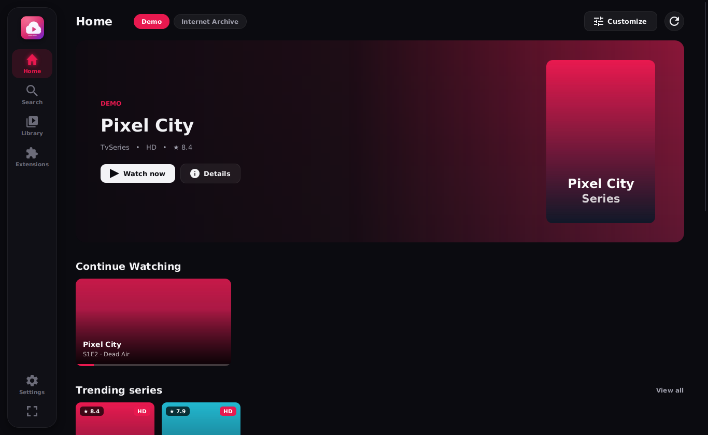
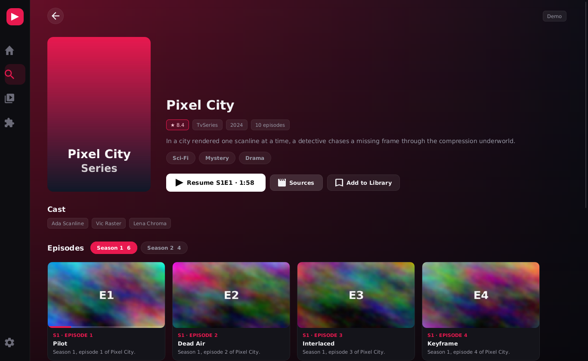
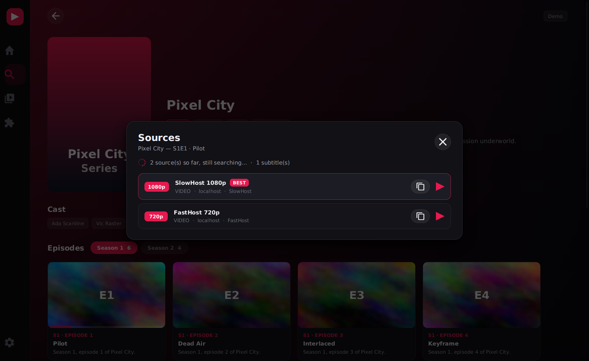
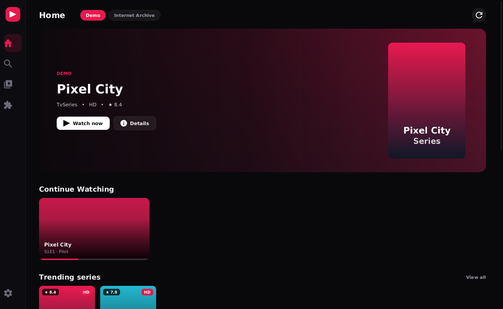
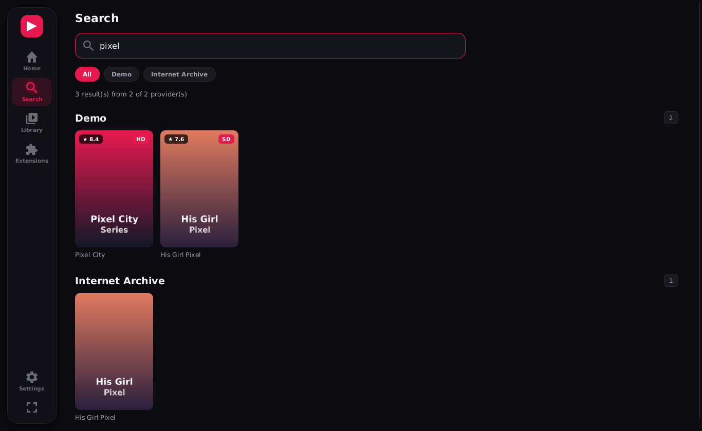
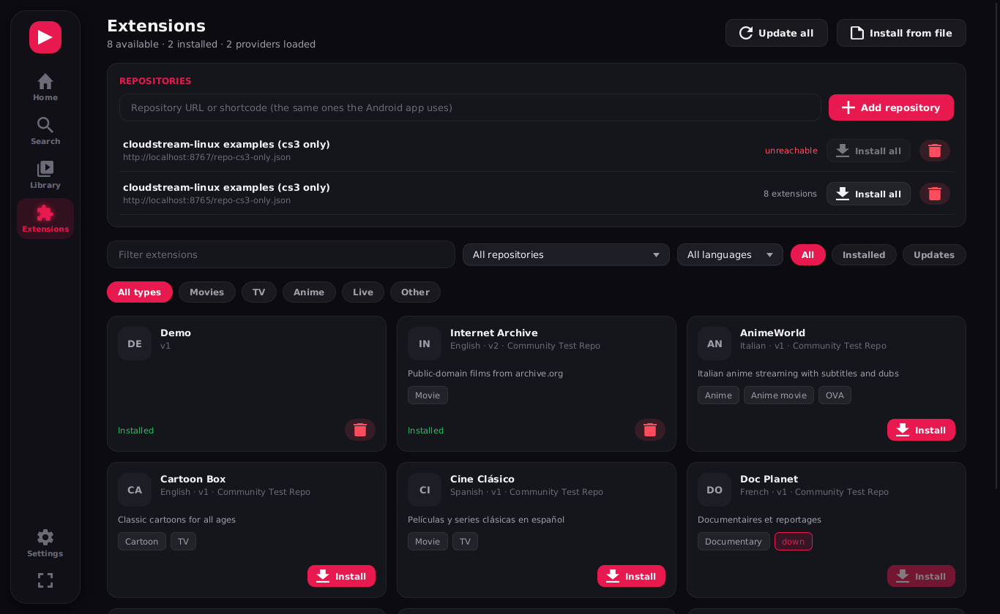

# CloudStream for Linux

Run **CloudStream extensions on Ubuntu/Linux**, from the same repositories the Android app uses, with no changes to the extensions.

- **Same extensions:** add repositories by URL, `cloudstreamrepo://` link or shortcode. Android `.cs3` files are translated from Dalvik to JVM bytecode automatically; cross-platform `.jar` builds are used directly.
- **Fast, streaming UI:** home sections, search results and video sources appear as each one arrives. A slow or dead site never blocks the rest, and the window opens immediately while extensions load in parallel.
- **Plays in mpv:** hardware decoding, with stream headers, referer, subtitles and audio tracks passed through. Playback position is tracked over mpv's IPC socket for **Resume**, **Continue Watching** and **Up next**.
- **Library:** bookmarks (My List), history and per-episode progress.
- **Network:** DNS-over-HTTPS (Cloudflare, Google, AdGuard, Quad9…) to get past ISP blocking, plus an HTTP cache.
- A full CLI is included for scripting.

| | |
|---|---|
|  |  |
|  |  |
|  |  |

*(Screenshots use the offline demo extension in `tests/DemoProvider`.)*

See **[docs/ANALYSIS.md](docs/ANALYSIS.md)** for how the Android app works, with file and line references.

## How it works

```
repo.json → plugins.json → Extension.cs3 ──dex2jar──► JVM classes ─┐
                         → Extension.jar (isCrossPlatform) ────────┤
                                                                   ▼
          PluginClassLoader ── parent ──► cs-library   (CloudStream's own `library`, compiled for JVM)
                                         android-shim  (Context, SharedPreferences, Plugin, CloudStreamApp, Log, Base64, Uri…)
                             ── last resort ──► AndroidStubLoader (empty placeholders for UI-only Android classes)
          Plugin.load(context) → registerMainAPI(...) → getMainPage / search / load / loadLinks → mpv
```

| Module | What it is |
|---|---|
| `cs-library/` | Builds upstream `library/` (`commonMain` + `jvmCommonMain` + `jvmMain`) and NiceHttp **from source**. Extensions link against the exact classes they were compiled for. |
| `android-shim/` | Linux implementations of the Android and app-module classes extensions call, with identical names and signatures. Extensions inline `getKey<T>()`, so signatures must match exactly. |
| `app/` | Repository manager, `.cs3` translator, parallel plugin loader, streaming engine, network (DoH/cache), mpv IPC bridge, library store, CLI, and the JavaFX UI (`ui/`). |
| `examples/InternetArchiveProvider/` | A complete extension (public-domain films from archive.org), built **both** as a real Dalvik `.cs3` and as a `.jar`, plus a ready-to-host `repo.json`. |
| `tests/` | Offline demo extension (series, slow host, dead host), mock site, fake mpv — used by the tests and screenshot tour. |

## Install (Ubuntu 22.04+)

```bash
sudo apt install openjdk-21-jdk git mpv
git clone <this repo> cloudstream-linux && cd cloudstream-linux
./scripts/fetch-upstream.sh        # pinned CloudStream + NiceHttp sources
./scripts/install.sh               # ~/.local install, app-menu entry, cloudstreamrepo:// handler
```

Or build a self-contained `.deb` with a bundled Java runtime:

```bash
./scripts/build-deb.sh                 # build/cloudstream-linux_<version>_amd64.deb
./scripts/uninstall-user-install.sh    # only if you used install.sh before (keeps your data)
sudo apt install ./build/cloudstream-linux_2.0.0_amd64.deb
# remove later with: sudo apt remove cloudstream-linux
```

## Use

Run `cloudstream-linux` (or open **CloudStream** from the app menu). Go to **Extensions**, paste a repository link, install extensions, then use **Home** and **Search**. Shortcuts: `/` or `Ctrl+F` to search, `Esc` to go back.

If a site doesn't load, try **Settings → DNS over HTTPS**. If a title won't play, open **Sources** to pick another source manually.

CLI:

```bash
cloudstream-linux repo add https://example.com/repo.json     # or cloudstreamrepo://…, or a shortcode
cloudstream-linux plugins                                    # what your repos offer (* installed, U update)
cloudstream-linux install <InternalName>|all
cloudstream-linux update
cloudstream-linux sideload ./SomeExtension.cs3
cloudstream-linux providers
cloudstream-linux home "<Provider>"
cloudstream-linux search "big buck bunny"
cloudstream-linux info  "<Provider>" <url>
cloudstream-linux links "<Provider>" <url> --item 3
cloudstream-linux play  "<Provider>" <url> --item 3 --player mpv
cloudstream-linux key set <key> <value>                     # extension settings (see below)
cloudstream-linux doctor                                    # diagnostics to include in bug reports
```

Data lives in `~/.local/share/cloudstream-linux` (override with `CLOUDSTREAM_HOME`). It uses the Android layout: `files/Extensions/<repo>/<plugin>.cs3` and a `prefs/` key store.

## Compatibility notes

- **Works:** extensions that use the CloudStream API (`MainAPI`, `app.get/post`, Jsoup, Jackson, built-in extractors, `loadExtractor`), `CloudStreamApp.getKey/setKey`, `android.util.Log/Base64`, `android.net.Uri`, `Toast`.
- **Settings screens:** an extension's `openSettings` is an Android Fragment and can't be shown. Most extensions read their settings via `getKey`, so set them with `cloudstream-linux key set`.
- **`requiresResources`:** Android resource tables aren't decoded; such extensions get an empty `Resources`.
- **WebView-based extensions** (e.g. Cloudflare challenges) don't work yet. Upstream's own JVM `WebViewResolver` is still unimplemented; the Sources panel says so when this is the cause.
- Logs are in `~/.local/share/cloudstream-linux/logs/` (Settings → Storage → Logs); please attach `cloudstream.log` and `cloudstream-linux doctor` output to bug reports.
- **YouTube** links are passed to mpv, which resolves them with yt-dlp. Upstream uses NewPipe, which is only published on JitPack.
- **Torrents** need `webtorrent-cli`.
- Any other Android class an extension touches gets a placeholder. The extension loads, but calling that code throws. Run with `CS_LOG_LEVEL=3` for debug logs.

## Write an extension that runs on both Android and Linux

Use `examples/InternetArchiveProvider` as a template. It is ordinary CloudStream extension code (`@CloudstreamPlugin class … : Plugin()`).

```bash
./gradlew :examples:InternetArchiveProvider:makeRepo -PrepoBaseUrl=https://you.github.io/repo
# build/repo/{repo.json, plugins.json, InternetArchive.cs3, InternetArchive.jar}
```

In a real recloudstream/gradle project, set `cloudstream { isCrossPlatform = true }` so your repo also publishes a `.jar`.

## Development

```bash
./gradlew :app:installDist && app/build/install/cloudstream-linux/bin/cloudstream-linux
./gradlew :app:test                 # extension loading, Android shims, streaming sources with a dead host, mpv IPC
python3 -I tests/mock-archive/server.py 8766   # local mock site for the demo/example extensions

# Scripted screenshot tour (any X display or xvfb-run):
PATH=$PWD/tests/fake-mpv:$PATH CS_SCREENSHOT=/tmp/shot CS_SCREENSHOT_SEARCH=pixel cloudstream-linux
```

CI (`.github/workflows/build.yml`) runs the tests on every push and publishes the `.deb` and tarball for every `v*` tag.

The upstream versions are pinned in `scripts/fetch-upstream.sh` (`CS_COMMIT`, `NICEHTTP_TAG`).

## License

GPL-3.0, the same as CloudStream, whose library sources this project compiles.
